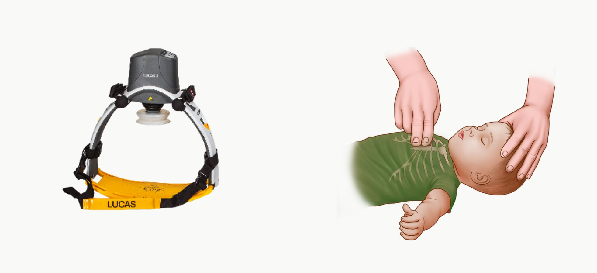
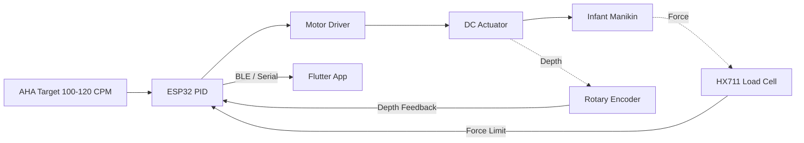

<p align="center">
  
</p>

<h1 align="center">OtoCPR (Auto-CPR for Infants)</h1>

<p align="center">
  Adaptive infant mechanical chest compression system with dual-feedback control and live telemetry.
</p>

<p align="center">
  
  
  
  
  
</p>

## Table of Contents

- [Overview](#overview)
- [Clinical Background and Problem Statement](#clinical-background-and-problem-statement)
- [System Architecture](#system-architecture)
  - [Dual-Feedback Control](#dual-feedback-control)
- [Hardware and PCB Design](#hardware-and-pcb-design)
  - [Custom PCB Details](#custom-pcb-details)
  - [3D Board View](#3d-board-view)
  - [Pin Mapping](#pin-mapping)
- [Firmware (ESP32)](#firmware-esp32)
  - [GPS Simulation](#gps-simulation)
  - [Build Environments](#build-environments)
- [Flutter Companion App](#flutter-companion-app)
- [Project Structure](#project-structure)
- [Quick Start](#quick-start)
  - [1. Firmware and Wokwi](#1-firmware-and-wokwi)
  - [2. Flutter App](#2-flutter-app)
- [Team](#team)

## Overview

OtoCPR is a portable mechanical chest compression device made for infants under 1 year old during CPR. It was developed at the Department of Electrical Engineering, Universitas Indonesia (FTUI), with pediatric intensive care specialists from FKUI-RSCM to reduce rescuer fatigue and keep compressions steady.

The system includes:

1. ESP32 motor control running on FreeRTOS.
2. Dual sensor feedback using a rotary encoder for depth and an HX711 load cell for force limits.
3. A custom 2-layer PCB with a 24V-to-5V buck regulator, level shifters, and motor driver wiring.
4. Wireless Bluetooth (BLE) and GPS data streamed to a Flutter app.

## Clinical Background and Problem Statement

Pediatric CPR guidelines from the American Heart Association (AHA) and European Resuscitation Council (ERC) recommend:

- Rate: 100 to 120 compressions per minute (CPM).
- Depth: about one-third of chest depth (roughly 3.5 to 4.0 cm).
- Recoil: full chest release between compressions.

<p align="center">
  
  <br />
  Figure 1: Adult mechanical CPR systems (left) compared with manual two-finger infant CPR (right).
</p>

Why OtoCPR is needed:

- Adult CPR machines (such as LUCAS 3) push 5.0 to 5.5 cm with over 300 N of force, which is unsafe for infants.
- Manual infant CPR causes hand fatigue within about 2 minutes, making depth and rate drop.
- Dedicated automated CPR devices for infants are rare, especially for ambulance transport and rural clinics.

## System Architecture

### Dual-Feedback Control

OtoCPR uses two sensors to keep compressions accurate and safe:

1. Depth control (Rotary Encoder):
   - A 600 PPR quadrature encoder (2400 counts per turn) tracks travel down to about 0.0033 mm per step.
   - A PID loop adjusts motor PWM output to hold the target stroke (3.5 to 4.0 cm) and speed (100 to 120 CPM).

2. Force limit (HX711 Load Cell):
   - A 24-bit load cell reads compression force continuously.
   - If force gets too high, the controller slows the motor and allows full recoil.



## Hardware and PCB Design

The electronics sit on a custom 2-layer KiCad PCB to avoid loose breadboard wires and cut electrical noise.

### Custom PCB Details

<p align="center">
  
  <br />
  Figure 2: 2D KiCad board layout and specifications (DESPRO 2026 Kelompok 20).
</p>

| Item                | Value                            | Notes                                           |
| :------------------ | :------------------------------- | :---------------------------------------------- |
| Board Size          | 60.00 mm x 100.00 mm             | Compact size for portable housing               |
| Layers              | 2 copper layers (top and bottom) | 1 oz copper (0.035 mm)                          |
| Material            | FR4, 1.51 mm core                | Total thickness 1.60 mm                         |
| Min Track / Spacing | 0.200 mm / 0.200 mm              | Wider traces for motor power                    |
| Min Hole Size       | 0.400 mm                         | Plated through-holes                            |
| Power Converter     | XL4015E1 DC-DC buck              | Steps 24V battery down to 5V (5A peak)          |
| Level Shifter       | Dual BSS138 N-MOSFET             | Converts 5V encoder signals to 3.3V             |
| Protection          | 3A glass fuse and SS34 diodes    | Surge, reverse polarity, and flyback protection |

### 3D Board View

<p align="center">
  
  <br />
  Figure 3: 3D render of the assembled control board.
</p>

### Pin Mapping

| Part                 | Module Pin      | ESP32 Pin           | Notes                                |
| :------------------- | :-------------- | :------------------ | :----------------------------------- |
| Main Power           | Buck Output     | 5V / GND            | 5V rail from XL4015 converter        |
| Logic Reference      | 3.3V Rail       | 3V3                 | Reference for level shifter and MCU  |
| Rotary Encoder ChA   | Output A        | GPIO 32 (or GPIO 2) | Pulse interrupt via level shifter    |
| Rotary Encoder ChB   | Output B        | GPIO 33 (or GPIO 3) | Direction signal via level shifter   |
| HX711 Load Cell      | DT / SCK        | GPIO 19 / GPIO 18   | Weight sensor data and clock         |
| Motor Driver PWM     | IN1 / IN2       | GPIO 25 / GPIO 26   | 5 kHz, 8-bit PWM speed and direction |
| Driver Enable        | EN              | GPIO 27             | Motor enable (active HIGH)           |
| I2C Display          | SDA / SCL       | GPIO 21 / GPIO 22   | Status LCD (0x27 or 0x3C)            |
| NEO-6M GPS           | TX / RX         | GPIO 16 / GPIO 17   | Serial2 at 9600 baud                 |
| Buzzer / Stop Button | Buzzer / Switch | GPIO 8              | Emergency alarm and manual stop      |

## Firmware (ESP32)

Built with PlatformIO and C++, the firmware splits motor control and data sending across both ESP32 cores. See [Firmware/README.md](./Firmware/README.md) for full firmware instructions.

- Core 1 (Motor Control):
  - Counts encoder pulses using hardware interrupts.
  - Runs the PID loop every 10 ms (100 Hz) with deadband handling.
- Core 0 (Sensors and Data):
  - Reads the HX711 load cell and NEO-6M GPS.
  - Sends a 14-column CSV line every 200 ms (5 Hz) over Bluetooth (BLE) and USB Serial (115200 baud).

CSV format:

```text
Time(ms),Set_RPM,Actual_RPM,PWM,Raw_Counts,Freq_Hz,LoadCell,GPS_Fix,Latitude,Longitude,Satellites,Speed_kmh,Altitude_m,GPS_UTC
```

### GPS Simulation

To test GPS without a physical module or outdoor signal:

- A built-in GPS emulator generates NMEA data inside the ESP32.
- A custom Wokwi GPS chip (Firmware/chips/gps-neo6m.chip.c) adds live sliders for speed, heading, satellites, and signal strength.

### Build Environments

```bash
# Standard build for real hardware or Wokwi
pio run -e esp32doit-devkit-v1

# Built-in GPS software simulator
pio run -e esp32doit-devkit-v1-gps-sim -t upload

# Wireless Bluetooth (BLE) telemetry build
pio run -e esp32doit-devkit-v1-ble -t upload

# Desktop GPS tests
pio test -e native
```

## Flutter Companion App

The Flutter app runs on Android, iOS, Windows, macOS, and Linux:

- System Monitor: live gauges and charts for target vs actual rate, depth, PWM, and force.
- GPS Tracker: live unit location during transport.
- Edge AI Diagnostics: uses a Gemma model pipeline to flag anomalies, overheating risk, and compression consistency.
- Two Connection Modes:
  1. Bluetooth (BLE): connects wirelessly to OtoCPR Unit 01.
  2. Wokwi TCP: connects to the local simulator on 127.0.0.1:4000 (or 10.0.2.2:4000 on Android Emulator).

## Project Structure

```text
otocpr-main/
├── README.md                  Project overview
├── Hardware/                  Schematics, BOM, and datasheets
│   ├── BOM.md                 Parts list
│   ├── Datasheet/             Component datasheets
│   └── Schematic/             KiCad files
├── Firmware/                  PlatformIO ESP32 firmware
│   ├── platformio.ini         Build environments and libraries
│   ├── diagram.json           Wokwi circuit wiring
│   ├── wokwi.toml             Wokwi config
│   ├── log_serial.py          CSV logger script
│   ├── src/                   Firmware source code
│   ├── lib/                   GPS parser and helper code
│   └── chips/                 Custom Wokwi GPS chip
├── docs/                      Reports and figures
├── lib/                       Flutter app source code
│   ├── main.dart              App entry point
│   ├── models/                Telemetry data models
│   ├── screens/               App pages
│   ├── services/              BLE and Wokwi connection handlers
│   └── widgets/               Charts, gauges, and cards
└── assets/                    Images and icons
```

## Quick Start

### 1. Firmware and Wokwi

1. Install VS Code with the PlatformIO IDE and Wokwi for VS Code extensions.
2. Open the Firmware folder in VS Code.
3. Build the firmware:
   ```bash
   pio run -e esp32doit-devkit-v1
   ```
4. Open Firmware/diagram.json and click Start Simulation (opens local port 4000).

### 2. Flutter App

1. Install Flutter (3.0 or newer).
2. Install packages:
   ```bash
   flutter pub get
   ```
3. Run the app:
   ```bash
   flutter run -d macos
   flutter run -d windows
   flutter run -d android
   ```
4. In the Robotic System card, open the menu and select Connect Wokwi Simulator (:4000), or scan for OtoCPR Unit 01 over Bluetooth.

## Team

- Raditya Danendra - Project Lead, Control and Embedded System
- Bryan Herdianto - Flutter App and Telemetry Pipeline
- Daffa Sayra Firdaus - Sensor Instrumentation and Edge AI
- Fathih Rayyandra Firmansyah - Power Management and Electronics
- Lukas Sudibyo Putra Parulian - Mechanical Design and Actuation
