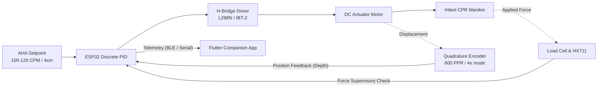
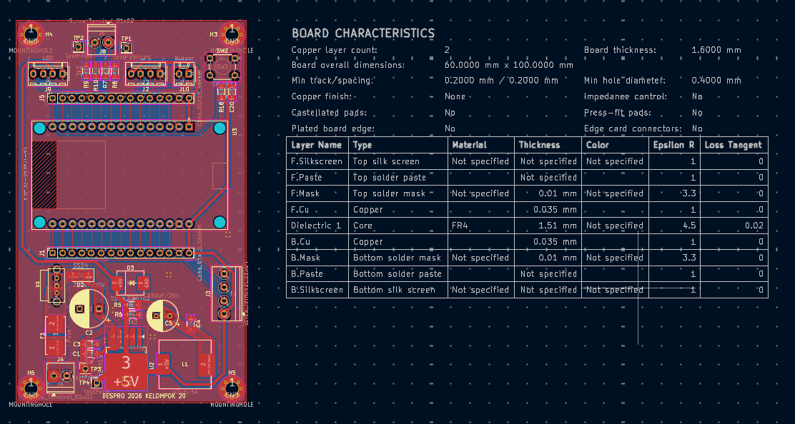
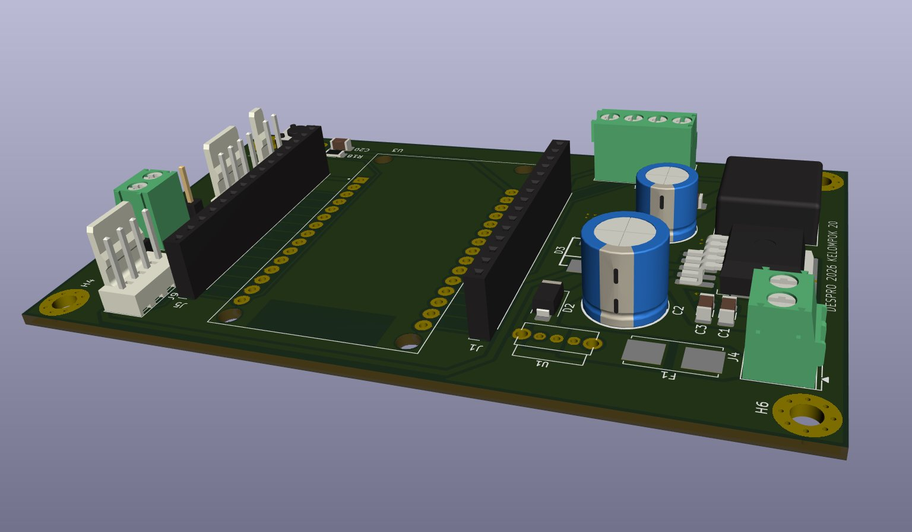

<p align="center">
  
</p>

<h1 align="center">OtoCPR (Auto-CPR for Infants)</h1>

<p align="center">
  <strong>Prototipe Alat Kompresi Dada Mekanik (Auto-CPR) Adaptif untuk Bayi dengan Kendali Lup Tertutup Feedback Ganda</strong>
</p>

<p align="center">
  <em>Adaptive Pediatric Mechanical Chest Compression System with Dual-Feedback Closed-Loop Control & Real-Time Telemetry</em>
</p>

<p align="center">
  
  
  
  
  
</p>

---

## 📌 Table of Contents

- [Overview](#-overview)
- [Clinical Background & Problem Statement](#-clinical-background--problem-statement)
- [Core Innovation & System Architecture](#-core-innovation--system-architecture)
  - [Dual-Feedback Closed-Loop Control](#dual-feedback-closed-loop-control)
  - [Block Diagram & Data Flow](#block-diagram--data-flow)
- [Hardware & PCB Design](#-hardware--pcb-design)
  - [Custom PCB Characteristics](#custom-pcb-characteristics)
  - [3D Board Visualization](#3d-board-visualization)
  - [Pin & Peripheral Mapping](#pin--peripheral-mapping)
- [Firmware Architecture (ESP32)](#-firmware-architecture-esp32)
  - [Telemetry & GPS Emulation](#telemetry--gps-emulation)
  - [Build Environments](#build-environments)
- [Cross-Platform Flutter Companion App](#-cross-platform-flutter-companion-app)
- [Project Directory Structure](#-project-directory-structure)
- [Quick Start Guide](#-quick-start-guide)
  - [1. Firmware & Wokwi Simulation](#1-firmware--wokwi-simulation)
  - [2. Flutter Application](#2-flutter-application)
- [Team & Acknowledgments](#-team--acknowledgments)

---

## 📖 Overview

**OtoCPR** is an adaptive, portable mechanical chest compression device engineered specifically for **infant patients (< 1 year old)** undergoing cardiopulmonary resuscitation (CPR). Developed under the Department of Electrical Engineering, Faculty of Engineering, Universitas Indonesia (FTUI) in collaboration with pediatric intensive care specialists from FKUI-RSCM, OtoCPR addresses the severe risks of rescuer fatigue and inconsistent compression biomechanics during emergency pediatric resuscitation.

The system combines:
1. **High-Precision Actuation**: Actuator driven by discrete PID control on an ESP32 microcontroller running deterministic FreeRTOS tasks.
2. **Dual-Feedback Closed-Loop Sensing**: High-resolution quadrature rotary encoder (depth tracking) paired with an HX711-amplified load cell (force limit supervisory protection).
3. **Custom Power & Signal PCB**: Dedicated 2-layer PCB integrating a high-efficiency 24V-to-5V step-down regulator, MOSFET level shifters, noise filtering, and motor driver interfaces.
4. **Wireless Telemetry & Cross-Platform Dashboard**: Live Bluetooth Low Energy (BLE) and GPS telemetry streamed to a multi-platform Flutter app for real-time monitoring and edge AI diagnostics.

---

## 🩺 Clinical Background & Problem Statement

Cardiopulmonary arrest in pediatric patients demands extreme precision. According to the **American Heart Association (AHA)** and **European Resuscitation Council (ERC)** guidelines:
- **Compression Rate**: 100 to 120 compressions per minute (CPM).
- **Compression Depth**: Approximately one-third of the infant's anterior-posterior (AP) chest diameter (approx. **3.5 cm to 4.0 cm**).
- **Chest Recoil**: Complete chest recoil between compressions without lingering residual force.

<p align="center">
  
  <br />
  <em>Figure 1: Commercial adult mechanical CPR systems (e.g., LUCAS 3, left) versus delicate manual two-finger compression required for infants (right).</em>
</p>

### The Clinical Dilemma:
- **Adult Mechanical CPR Incompatibility**: Devices such as the LUCAS 3 system are built for adult anatomies. Their stroke depth (5.0–5.5 cm) and compressive force (> 300 N) would cause fatal rib fractures, internal hemorrhaging, or cardiac rupture in an infant.
- **Rescuer Fatigue in Manual CPR**: Rescuers performing manual chest compressions (two-finger or two-thumb encircling technique) experience measurable muscle fatigue within **2 minutes**, causing compression depth to degrade and rate to drift outside therapeutic windows.
- **Lack of Infant-Specific Solutions**: Commercial, certified automated CPR devices dedicated to the pediatric and infant demographic are virtually nonexistent, especially in emergency transport, rural triage, or disaster relief contexts.

OtoCPR solves this gap by delivering **consistent, safe, automated compressions** calibrated strictly to infant physiological thresholds.

---

## ⚙️ Core Innovation & System Architecture

### Dual-Feedback Closed-Loop Control

The device employs a dual-sensor control topology to prevent trauma while guaranteeing therapeutic depth:

1. **Primary Loop — Depth Regulation (Rotary Encoder)**:
   - An optical quadrature rotary encoder with 600 PPR (2,400 counts/revolution via 4x decoding) tracks linear displacement down to **$\approx 0.0033\text{ mm}$** per step.
   - A discrete PID loop adjusts motor PWM duty cycle at high frequency to maintain exact stroke amplitude (3.5–4.0 cm) and cycle speed (100–120 CPM).

2. **Secondary Supervisory Loop — Force Limiting (HX711 Load Cell)**:
   - A 24-bit ADC load cell sensor continuously measures instantaneous compression force.
   - If the force approaches anatomical tolerance thresholds (preventing excessive chest wall pressure), the supervisory routine immediately throttles actuator output and enforces full recoil.



---

## 🔌 Hardware & PCB Design

The electronics are consolidated onto a custom-designed **Printed Circuit Board (PCB)** created in KiCad, eliminating unreliable breadboard wiring and providing high electrical noise immunity.

### Custom PCB Characteristics

<p align="center">
  
  <br />
  <em>Figure 2: 2D KiCad board layout, mechanical footprint, and board fabrication specifications (DESPRO 2026 Kelompok 20).</em>
</p>

| Parameter | Specification | Notes |
| :--- | :--- | :--- |
| **Board Dimensions** | 60.00 mm $\times$ 100.00 mm | Compact form factor for portable housing |
| **Layer Count** | 2 Copper Layers (Top & Bottom) | 1 oz copper ($0.035\text{ mm}$) |
| **Substrate / Core** | FR4 Standard, $1.51\text{ mm}$ Core | Total board thickness: $1.60\text{ mm}$ |
| **Track / Spacing** | Min $0.200\text{ mm}$ / $0.200\text{ mm}$ | Optimized current-carrying traces for motor lines |
| **Min Hole Diameter**| $0.400\text{ mm}$ | Plated through-holes |
| **Power Management** | XL4015E1 DC-DC Buck Converter | Steps 24V battery input down to regulated 5V (5A peak) |
| **Logic Interfacing**| Dual BSS138 N-MOSFET level shifter | Bi-directional 5V to 3.3V logic translation for encoder |
| **Protection** | 3A glass fuse + SS34 Schottky diodes | Surge, reverse polarity, and back-EMF suppression |

### 3D Board Visualization

<p align="center">
  
  <br />
  <em>Figure 3: 3D ray-traced rendering of the assembled OtoCPR control board showing screw terminals, ESP32 header sockets, power inductor, and decoupling capacitors.</em>
</p>

### Pin & Peripheral Mapping

| Peripheral | Module Pin | ESP32 Pin | Function & Logic Level |
| :--- | :--- | :--- | :--- |
| **Main Power Rail** | Buck Output | `5V` / `GND` | System 5V rail from XL4015 buck converter |
| **Logic Reference** | 3.3V Rail | `3V3` | Level shifter high side & MCU reference |
| **Rotary Encoder ChA** | Output A | `GPIO 32` (or `GPIO 2`) | Quadrature interrupt channel (via level shifter) |
| **Rotary Encoder ChB** | Output B | `GPIO 33` (or `GPIO 3`) | Direction sense channel (via level shifter) |
| **HX711 Load Cell** | `DT` / `SCK` | `GPIO 19` / `GPIO 18` | Non-blocking serial reading of compression load |
| **Motor Driver PWM** | `IN1` / `IN2` | `GPIO 25` / `GPIO 26` | 5 kHz 8-bit PWM direction & speed control |
| **Driver Enable** | `EN` | `GPIO 27` | Active-HIGH hardware disable |
| **OLED / LCD Display**| `SDA` / `SCL` | `GPIO 21` / `GPIO 22` | I2C status screen (`0x27` or `0x3C`) |
| **u-blox NEO-6M GPS**| `TX` / `RX` | `GPIO 16` / `GPIO 17` | UART2 9600-baud NMEA 0183 telemetry |
| **Alarm Buzzer / SW**| Buzzer / Tact | `GPIO 8` | Audible emergency alarm and manual stop switch |

---

## 💻 Firmware Architecture (ESP32)

Developed using **PlatformIO** and modern C++ for ESP32, the firmware separates hard real-time motor control from communication and telemetry tasks:

- **Core 1 (High-Priority Real-Time Task)**:
  - Quadrature encoder pulse counting via high-speed hardware ISR.
  - Discrete PID computation loop executed every 10 ms ($100\text{ Hz}$).
  - PWM generation with anti-windup and dynamic deadband compensation.
- **Core 0 (Telemetry & Communication Task)**:
  - HX711 non-blocking load cell polling.
  - GPS NMEA parser (`TinyGPSPlus`) extracting coordinates, speed, and timestamp.
  - Bluetooth Low Energy (BLE) GATT server broadcasting structured 14-column CSV rows every 200 ms ($5\text{ Hz}$).
  - Fallback serial transmission (115,200 baud).

### Telemetry Stream Format

```text
Time(ms),Set_RPM,Actual_RPM,PWM,Raw_Counts,Freq_Hz,LoadCell,GPS_Fix,Latitude,Longitude,Satellites,Speed_kmh,Altitude_m,GPS_UTC
```

### Telemetry & GPS Emulation
To allow complete end-to-end testing without external GPS lock:
- An internal **NMEA 0183 v2.3 emulator** (`$GPRMC`, `$GPGGA`, `$GPVTG`) runs within the firmware.
- A custom **WebAssembly (WASM) GPS chip** (`chips/gps-neo6m.chip.c`) provides interactive satellite lock, speed, and heading sliders in the **Wokwi** simulator.

### Build Environments (`platformio.ini`)

```bash
# 1. Standard build for physical hardware or Wokwi simulator
pio run -e esp32doit-devkit-v1

# 2. In-firmware GPS software emulator
pio run -e esp32doit-devkit-v1-gps-sim -t upload

# 3. Wireless BLE GATT telemetry mode
pio run -e esp32doit-devkit-v1-ble -t upload

# 4. Native unit tests for NMEA and checksum verification
pio test -e native
```

---

## 📱 Cross-Platform Flutter Companion App

The repository includes a modern, responsive **Flutter** dashboard targeting Android, iOS, Windows, macOS, and Linux:

- **Robotic System Monitor**: Live dial and waveform visualization of target vs actual compression rate (RPM/CPM), compression depth, motor PWM, and applied force.
- **GPS Ambulance Tracker**: Real-time geolocation of the active unit during transport.
- **Edge AI Telemetry Diagnostics**: Evaluates internal machine telemetry (`Gemma` edge AI model pipeline) for predictive anomaly detection, overheating risk, and compression consistency scoring.
- **Dual Connection Modes**:
  1. **Wireless BLE**: Connects directly to `OtoCPR Unit 01` over Bluetooth GATT notifications.
  2. **Wokwi TCP Bridge**: Connects via socket (`127.0.0.1:4000` or `10.0.2.2:4000`) to test the full stack inside the simulator without physical hardware.

---

## 📁 Project Directory Structure

```text
otocpr-main/
├── README.md                      # Primary project documentation
├── Hardware/                      # Hardware schematics, BOM, and pinouts
│   ├── BOM.md                     # Component Bill of Materials & suppliers
│   ├── Datasheet/                 # Component datasheets (XL4015, HX711, L298N)
│   └── Schematic/                 # KiCad schematics and layout source
├── Firmware/                      # PlatformIO ESP32 embedded codebase
│   ├── platformio.ini             # Build environments and library dependencies
│   ├── diagram.json               # Wokwi circuit simulation wiring
│   ├── wokwi.toml                 # Wokwi simulation configuration
│   ├── log_serial.py              # Telemetry CSV logger script
│   ├── src/                       # Main C++ source files (PID, BLE, GPS, LCD)
│   ├── lib/                       # NMEA parser and helper libraries
│   └── chips/                     # Custom WebAssembly NEO-6M GPS chip for Wokwi
├── docs/                          # Project documentation and visual assets
│   ├── LAPORAN KEMAJUAN...docx    # Comprehensive academic progress report
│   └── images/                    # Schematics, 3D PCB, and comparison figures
│       ├── cpr_comparison_lucas_vs_infant.jpg
│       ├── pcb_characteristics_layout.png
│       └── pcb_3d_render.jpg
├── lib/                           # Flutter mobile & desktop application source
│   ├── main.dart                  # Flutter entry point
│   ├── models/                    # Data models for 14-column telemetry
│   ├── screens/                   # UI dashboards (Home, AI Telemetry, Logs)
│   ├── services/                  # BLE and Wokwi TCP repository
│   └── widgets/                   # Real-time charts, gauges, and status cards
└── assets/                        # Static UI assets (logos, images, vectors)
```

---

## 🚀 Quick Start Guide

### 1. Firmware & Wokwi Simulation

1. Install [VS Code](https://code.visualstudio.com/) and the **PlatformIO IDE** extension.
2. Install the **Wokwi for VS Code** extension.
3. Open the `Firmware/` directory in VS Code.
4. Press `Ctrl+Shift+P` (or `Cmd+Shift+P` on macOS) $\rightarrow$ **Wokwi: Start Simulator**.
5. The ESP32 will boot, output telemetry to the serial terminal, and expose an RFC2217 port on `127.0.0.1:4000`.

### 2. Flutter Application

1. Ensure the [Flutter SDK](https://docs.flutter.dev/get-started/install) is installed ($\ge 3.0$).
2. Install dependencies:
   ```bash
   flutter pub get
   ```
3. Run on your preferred development target:
   ```bash
   # Run on Desktop (macOS / Windows / Linux)
   flutter run -d macos

   # Run on Connected Android Device or Emulator
   flutter run -d android
   ```
4. In the app's **Robotic System** card, open the options menu and select **Connect Wokwi Simulator (:4000)** or scan for **OtoCPR Unit 01** via Bluetooth.

---

## 👥 Team & Acknowledgments

This project is conducted as part of **Desain Proyek 2 (DESPRO 2026) — Kelompok 20**, Department of Electrical Engineering, Faculty of Engineering, **Universitas Indonesia**.

### Development Team
- **Raditya Danendra** (2306218420) — Project Lead / Control & Embedded System
- **Bryan Herdianto** (2306210885) — Power Management & Electronics
- **Daffa Sayra Firdaus** (2306267151) — Mechanical Design & Actuation
- **Fathih Rayyandra Firmansyah** (2306205260) — Flutter App & Telemetry Pipeline
- **Lukas Sudibyo Putra Parulian** (2306264603) — Sensor Instrumentation & Edge AI

### Clinical Client & Advisor
- **Dr. dr. Irene Yuniar, Sp.A(K)**  
  *Pediatric Intensive Care Unit (PICU) Consultant & Lecturer, Department of Child Health, FKUI-RSCM / RSUI*  
  *Trainer, Advanced Pediatric Resuscitation Course (APRC) — Ikatan Dokter Anak Indonesia (IDAI)*

### Academic Supervisor
- **Siti Fauziyah Rahman, S.T., M.Eng., Ph.D.**  
  *Department of Electrical Engineering, Faculty of Engineering, Universitas Indonesia*

---

<p align="center">
  <sub>© 2026 OtoCPR Team — Departemen Teknik Elektro FTUI. Released for academic, research, and non-commercial open healthcare development.</sub>
</p>
